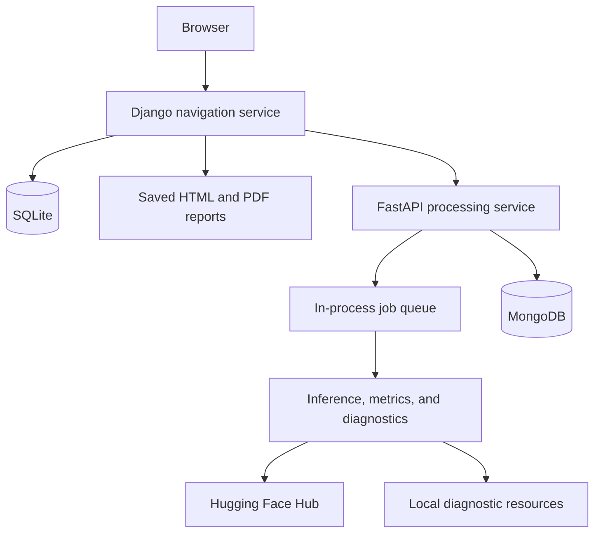

# MIRA

MIRA is a web-based toolkit for investigating undesirable behavior in language models. It brings together task evaluation, diagnostic tests, token attribution, and result comparison in a project-based workflow.

The application separates a **Django navigation service**, which provides the interface, from a **FastAPI processing service**, which loads models and datasets, executes jobs, and stores evaluation results. Both services can run on one machine, or navigation can connect to a remote processing machine.

> **Deployment status:** The included configurations are intended for development and controlled research environments. They are not hardened for public deployment. Read [Security and current limitations](#security-and-current-limitations) before exposing any service.

## Contents

- [Capabilities](#capabilities)
- [Architecture](#architecture)
- [Requirements](#requirements)
- [Quick start](#quick-start)
- [Configuration](#configuration)
- [Deployments](#deployments)
- [Data and persistence](#data-and-persistence)
- [Development](#development)
- [Repository structure](#repository-structure)
- [Potential issues](#potential-issues)
- [Security and current limitations](#security-and-current-limitations)
- [License](#license)

## Capabilities

### Task evaluation

The processing service implements three main inference workflows:

| Task | Workflow | Included model |
|---|---|---|
| Text retrieval | BM25 candidate retrieval followed by cross-encoder reranking | `Alibaba-NLP/gte-reranker-modernbert-base` |
| Summarization | Encoder-decoder text generation | `pszemraj/long-t5-tglobal-base-16384-book-summary` |
| Text simplification | Chat-template-based causal language-model generation | `Qwen/Qwen2-1.5B-Instruct` |

The included task datasets are:

- `dtk-llms/mira_rag_queries`
- `dtk-llms/mira_summarization`
- `dtk-llms/mira_simplification`

Additional Hugging Face model and dataset IDs can be configured, provided they are compatible with the relevant inference path. Catalog registration does not guarantee compatibility with every task, metric, or diagnostic.

The retrieval workflow returns ranked documents; it does **not** implement answer generation over retrieved content.

### Metrics and diagnostics

Available metric implementations cover:

- **Classification:** accuracy, precision, recall, and F1.
- **Retrieval:** average precision, mean average precision, NDCG, and MRR.
- **Generation:** ROUGE, BLEU, METEOR, BERTScore, and SARI.
- **Additional analysis:** readability, WeCheck, HaRiM+, perplexity, correct-word ranking, and rule-based compliance checking.

Registered diagnostic implementations include:

- LM Diagnostics accuracy and sensitivity
- HANS
- NLI Stress Test
- SentEval
- HolisticBias
- LXT relevance attribution
- SHAP-style attribution using Captum Shapley Value Sampling
- Encoder SHAP attribution
- Encoder Integrated Gradients

Diagnostics have model- and task-specific requirements. In particular, generation attribution has narrower architecture support than ordinary inference. CC-SHAP source code is included but is not registered as an available diagnostic.

See [`processing/app/config/`](processing/app/config/) for catalogs and [`processing/app/models/`](processing/app/models/) for implementations.

### Tool navigation

The tool supports:

- Project creation with configurable models, datasets, metrics, and task parameters.
- Selection of **Should-Know (SK)** and **Really-Know (RK)** diagnostic tests.
- Test grouping and method configuration.
- Job submission, progress tracking, cancellation requests, and log inspection.
- Inspection of predictions, metric summaries, and diagnostic outputs.
- Job tagging, comparison, and comments.
- HTML/PDF report generation and JSON/CSV raw-data exports.

## Architecture



- **Project:** model selection and shared evaluation configuration.
- **Test:** a collection of related evaluation methods or diagnostics.
- **Method:** dataset, metrics, and execution parameters.
- **Job:** an execution attempt with status and logs.
- **Result:** predictions, analysis, and diagnostic output.

Navigation stores local project, test, and method records in SQLite. Processing stores execution records and results in MongoDB. Synchronization connects the two, but navigation is not a complete offline mirror of processing.

Jobs run in threads inside the processing application.

## Requirements

### Docker

- Docker Engine or Docker Desktop.
- Docker Compose v2, using `docker compose`.
- Internet access for image builds and on-demand model, dataset, and metric downloads.
- Visibility over GPUs for inference and diagnostics.
- Depending on the size of the language models you are working with, adjustments to the limits currently configured may be needed.

### GPU deployment

The supplied GPU configurations require:

- An NVIDIA GPU and compatible host driver.
- NVIDIA Container Toolkit configured for Docker.
- A Linux environment capable of running the supplied CUDA containers.

The GPU image uses a CUDA 12.4 base. The default [`docker-compose.yml`](docker-compose.yml) does not request an NVIDIA GPU.

### Native development

- Python **3.13**, matching the checked-in `.python-version` files.
- [`uv`](https://docs.astral.sh/uv/).
- MongoDB; the Compose configurations use MongoDB 8.0.
- `wkhtmltopdf` for PDF export.

Each service has its own `pyproject.toml` and `uv.lock`.

## Quick start

Run the following commands from the repository root.

### 1. Configure the environment

Environment example files are not currently included. Create a local `.env` file containing:

```dotenv
DJANGO_SECRET_KEY=replace-with-a-long-random-secret
DJANGO_DEBUG=True
DJANGO_ALLOWED_HOSTS='["localhost","127.0.0.1"]'

MONGO_USERNAME=mira
MONGO_PASSWORD=replace-with-a-strong-password
MONGO_HOST=processing-db
MONGO_PORT=27017

PROCESSING_SERVICE_URL=http://processing:8000
NAVIGATION_SERVICE_URL=http://navigation:8000

LOGGING_LEVEL=INFO
APP_NAME=MIRA
LICENSE=Apache License 2.0
```

These service URLs are **container-to-container addresses**. From the host, processing is available on port `8001`.

> Keep credentials out of version control. The current root `.gitignore` ignores `.env.navigation`, `.env.processing`, and `.env.vm`, but does not explicitly ignore `.env`.

`DJANGO_DEBUG=True` is appropriate only for local development. With the current settings implementation, use an empty value (`DJANGO_DEBUG=`) to disable debug mode; the string `False` incorrectly enables it.

### 2. Build and start the services

```sh
docker compose --env-file .env --profile all -p mira up --build -d
```

Inspect startup status and logs:

```sh
docker compose --env-file .env --profile all -p mira ps
docker compose --env-file .env --profile all -p mira logs --tail=100
```

Navigation runs Django migrations automatically on container startup. Database seeding is a separate step.

### 3. Seed the diagnostic templates

Once processing and MongoDB are ready:

```sh
bash scripts/seed_dbs.sh
```

This script:

1. Loads default test and method templates into MongoDB.
2. Runs navigation's `pull_from_processing_service` management command.

The current processing seeder does not create demonstration projects or download every model and dataset. An empty project list after seeding is therefore expected.

The scripts use the fixed container names `processing_service` and `navigation_service`. They do not accept the positional URL or database arguments shown in older setup guides.

### 4. Open the application

- **Web interface:** http://localhost:8000/
- **Processing API documentation:** http://localhost:8001/docs
- **Processing health endpoint:** http://localhost:8001/health

The processing health endpoint is a basic HTTP check, not a full database, model, or worker-readiness check.

### 5. Stop the application

```sh
docker compose --env-file .env --profile all -p mira down
```

Do not add `-v` unless you intend to remove the deployment's named volumes, including its MongoDB data volume.

## Configuration

### Environment variables

| Variable | Purpose |
|---|---|
| `DJANGO_SECRET_KEY` | Django application secret; must be supplied. |
| `DJANGO_DEBUG` | Debug flag. Currently, any nonempty string enables debug mode. |
| `DJANGO_ALLOWED_HOSTS` | JSON array of accepted hostnames/IPs, without schemes or ports. |
| `PROCESSING_SERVICE_URL` | Processing API address used by navigation; also used by seeding code. |
| `NAVIGATION_SERVICE_URL` | Navigation address passed through deployment configuration. |
| `MONGO_HOST`, `MONGO_PORT` | MongoDB connection address. |
| `MONGO_USERNAME`, `MONGO_PASSWORD` | MongoDB credentials, authenticated against `admin`. |
| `NUM_WORKERS` | Processing worker-thread count; defaults to `1`. |
| `REPORT_DIR` | Navigation directory for saved report copies. |
| `HF_HOME` | Hugging Face cache location. |
| `HF_TOKEN` | Hugging Face token for resources requiring authentication, when passed to processing. |
| `LOGGING_LEVEL` | Processing log verbosity. |

Important configuration details:

- `DJANGO_ALLOWED_HOSTS` must be valid JSON, for example `["localhost","127.0.0.1"]`, not a comma-separated string.
- Compose only passes explicitly configured environment variables into containers. Adding `HF_TOKEN` or `NUM_WORKERS` to an environment file is insufficient unless the selected service definition also forwards it.

For gated Hugging Face resources, obtain the required access and pass a token securely. Do not place tokens in source files.

## Deployments

### Deployment files

| File | Services | Notes |
|---|---|---|
| `docker-compose.yml` | Navigation, processing, MongoDB | Non-GPU configuration; profiles: `all`, `navigation`, `processing`. |
| `docker-compose.cuda.yml` | Navigation, GPU processing, MongoDB | Standalone configuration with host-specific storage paths. |
| `docker-compose.processing.yml` | GPU processing, MongoDB | Processing side of a distributed deployment. |
| `docker-compose.navigation.yml` | Navigation | Connects to a remote processing service. |

`docker-compose.cuda.yml` is a complete deployment file, not an override to layer onto the default file. There is no `docker-compose.vm.yml` in the current repository.

### Single-machine GPU deployment

_This is the configuration used in our work_.

Review `docker-compose.cuda.yml` before use. It binds caches, reports, and MongoDB data beneath:

```text
/data/dtk_storage/docker/
```

Create writable directories there or change the mounts to suit your machine.

Create `.env.vm` with the required settings, then run:

```sh
docker compose -f docker-compose.cuda.yml --env-file .env.vm -p mira up --build -d
bash scripts/seed_dbs.sh
```

For container-to-container communication, use `http://processing:8000`, `http://navigation:8000`, and `MONGO_HOST=processing-db`.

If accessing navigation remotely, add its hostname or IP to `DJANGO_ALLOWED_HOSTS`.

### Distributed deployment

_This is a minimal guide to deploy the toolkit in a distributed manner_.

On the **processing machine**, create `.env.processing` with MongoDB credentials and deployment URLs. Use `MONGO_HOST=processing-db`, then run:

```sh
docker compose -f docker-compose.processing.yml --env-file .env.processing -p mira-processing up --build -d
bash scripts/seed_processing.sh
```

On the **navigation machine**, create `.env.navigation` with Django settings and:

```dotenv
PROCESSING_SERVICE_URL=http://processing-machine:8001
NAVIGATION_SERVICE_URL=http://navigation-machine:8000
```

Replace the example hostnames with addresses reachable from the relevant containers. Start navigation and synchronize:

```sh
docker compose -f docker-compose.navigation.yml --env-file .env.navigation -p mira-navigation up --build -d
bash scripts/seed_navigation.sh
```

Navigation needs access to the processing API. It does not need direct access to MongoDB; do not open MongoDB publicly for this workflow.

## Data and persistence

MIRA uses both runtime downloads and repository-local resources.

| Data | Location |
|---|---|
| Navigation records and Django sessions | `navigation/database.sqlite3` |
| Processing records, jobs, results, logits, and applied tags | MongoDB database `mira-processing` |
| Processing logs | `processing/app/logs/` |
| Model, dataset, metric, diagnostic, and tag catalogs | `processing/app/config/` |
| Default test/method seed definitions | `processing/app/database/seeds/` |
| Local diagnostic resources and vendored data | `processing/app/data/` |
| Saved reports | Configured `REPORT_DIR`, if writable |
| Downloaded models and datasets | Hugging Face cache |

The default Compose deployment persists MongoDB in a named volume and mounts both source directories into their containers.

Additional persistence considerations:

- The default and navigation-only Compose files do **not** mount `/reports`. Add a persistent mount or configure `REPORT_DIR` beneath a mounted directory if saved reports should survive container replacement.
- The default Compose file declares `processing_hf_cache` but does not mount it. Add an explicit cache mount to retain downloads across container replacement.
- The CUDA configuration provides explicit host mounts for reports and the Hugging Face cache.
- Model/dataset registration can modify local JSON catalogs, so those directories must be writable.

Note that some diagnostic datasets are bundled with the current implementation rather than downloaded from HF's Hub. See following section for info about these.

### Additional data

Additional data needs to be downloaded for diagnostics and BM25 (if re-running our study setup is what you want).

You can get them from this [google drive folder](https://drive.google.com/drive/folders/1uOAPF4mjIIjaxIIGC9EK_bc5Fq55CYsf?usp=sharing).
- bm25_indices: place them in `processing/app/bm25_indices`.
- data: place these in `processing/app/data`.

## Development

### Navigation

From `navigation/`, with environment variables already exported:

```sh
uv sync --locked
uv run python manage.py migrate
uv run python manage.py runserver 127.0.0.1:8000
```

For a locally running processing service:

```sh
export PROCESSING_SERVICE_URL=http://127.0.0.1:8001
```

To import existing processing-side projects and their configuration:

```sh
uv run python manage.py pull_from_processing_service
```

An explicit URL can also be supplied:

```sh
uv run python manage.py pull_from_processing_service --url http://127.0.0.1:8001
```

Install `wkhtmltopdf` separately if developing outside Docker and using PDF export.

### Processing

From `processing/`, with MongoDB running and its connection variables exported:

```sh
uv sync --locked
uv run python -c "import nltk; nltk.download('punkt_tab')"
uv run python -m uvicorn app.main:app --host 127.0.0.1 --port 8001 --lifespan=on
```

Use `MONGO_HOST=127.0.0.1` when connecting through a locally published MongoDB port.

Run the seeder separately from `processing/`:

```sh
uv run python -m app.database.database_seeder
```

Keep `processing/` as the working directory: some diagnostic implementations use relative `app/data/...` paths.

Distributed job claiming is not implemented.

### API
Use the generated API documentation for request schemas and query parameters. Main route groups include:

```text
/models       /datasets     /tasks        /metrics
/projects     /tests        /methods      /jobs
/results      /tags         /web/metadata
```

## Repository structure

```text
.
├── README.md
├── LICENSE
├── docker-compose.yml
├── docker-compose.cuda.yml
├── docker-compose.navigation.yml
├── docker-compose.processing.yml
├── navigation/
│   ├── Dockerfile.multistage
│   ├── docker-entrypoint.sh
│   ├── manage.py
│   ├── pyproject.toml
│   ├── uv.lock
│   ├── nav_core/                    # Django settings and root URLs
│   ├── projects/                    # Models, views, forms, UI, reports, sync
│   ├── routes/                      # Processing API adapters
│   └── templates/                   # Shared interface components
├── processing/
│   ├── Dockerfile.multistage
│   ├── Dockerfile.multistage.gpu
│   ├── mongo-init.js
│   ├── pyproject.toml
│   ├── uv.lock
│   └── app/
│       ├── main.py                  # FastAPI entrypoint
│       ├── config/                  # Catalogs and service registry
│       ├── routers/                 # HTTP routes
│       ├── controllers/             # Application operations
│       ├── models/                  # Records, metrics, diagnostics
│       ├── services/                # Loading, inference, queue, persistence
│       ├── database/                # Seeder and seed definitions
│       ├── data/                    # Local diagnostic resources
│       └── bm25_indices/            # Stored index artifacts
└── scripts/
    ├── seed_dbs.sh
    ├── seed_navigation.sh
    ├── seed_processing.sh
    ├── index_bm25_corpus.py
    └── cleanup_disk_space.sh
```

## Potential issues

**Navigation cannot reach processing**: Verify the address from navigation's environment. Since Docker is in use, `localhost` inside a container refers to that container, not another service or the host. Check Docker's logs for information specific to your case.

- Combined Compose deployment: `http://processing:8000`
- Native execution on the same host: `http://127.0.0.1:8001`
- Distributed deployment: a reachable processing hostname/IP on port `8001`

**Diagnostic choices are missing**: Run the processing seeder (`scripts/seed_processing.sh`) and inspect its output. Note that this should be run right after the creation of the containers.

**MongoDB authentication fails**: Check that application credentials match the credentials used when the MongoDB volume was initialized. Editing environment variables does not recreate users in an existing database.

**PDF generation fails**: Confirm that `wkhtmltopdf` is available to navigation. Inspect navigation logs for rendering errors. HTML report download can help distinguish report-data problems from PDF-rendering problems.

**Container-name or network conflicts**: The Compose files use fixed container names and subnets. Adjust accordingly.

**Disk usage**: Model checkpoints, logits, logs, results, and reports are stored locally and can take up significant space. You can use `scripts/cleanup_disk_space.sh`, but _review it carefully_ before running it. It prunes Docker artefacts, older reports, and cached files, too.

## Security and current limitations

- No access-control is implemented.
- Compose publishes ports `8000`, `8001`, and `27017` for debugging purposes. Handle ports accordingly to your setup.
- Navigation's container uses Django's development server.
- `DJANGO_DEBUG=False` is in use.
- FastAPI's browser CORS origins are hard-coded for local development.
- Horizontal scaling for jobs is not yet supported.
- Model/dataset downloads assume you have the right permissions from Hugging Face (e.g., in the case of gated models). Review their license and access requirements before use.

## License and contacts

The repository is licensed under the **Apache License 2.0**. See [`LICENSE`](LICENSE).

Downloaded models, datasets, and bundled third-party resources may have separate licenses and usage conditions.

For questions, please contact [Lorenzo](https://lcorti.github.io/).

## Citation

If you find this work useful, please cite it:

```bibtex
To add.
```
